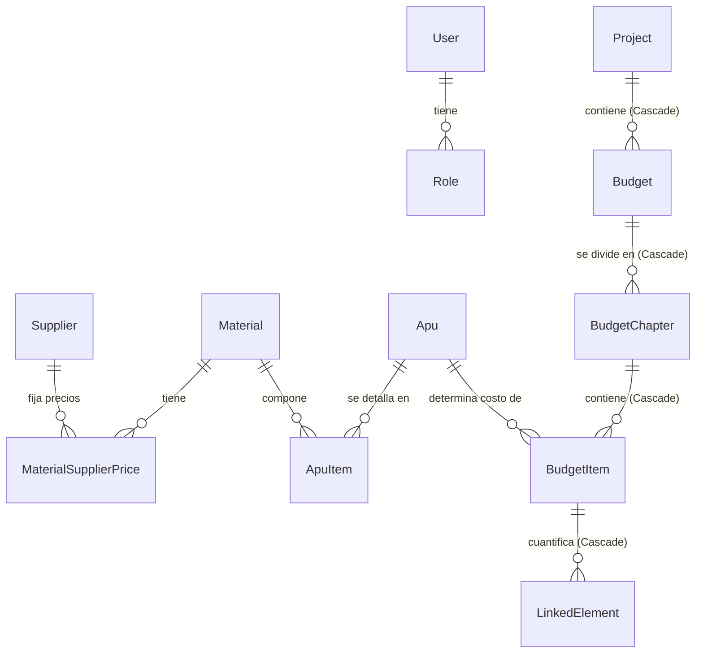

# Base de Datos Unificada (Web App + Revit Add-in) 🌐🔌

Este directorio contiene el diseño unificado de la base de datos que fusiona la estructura del **proyecto web de la empresa** con las tablas y metadatos que requiere el **Add-in de Revit** para almacenar la vinculación de elementos 3D.

---

## 💡 Recomendación de Arquitectura e Integración

Para lograr que el Add-in consuma la estructura creada desde la Web y solo se encargue de asociar elementos de Revit, la mejor estrategia es **extender el esquema de base de datos del proyecto web de la empresa**.

### ¿Por qué esta estrategia?

1. **Única Fuente de Verdad**: La estructura de presupuestos, capítulos y actividades se gestiona exclusivamente en la plataforma web. El Add-in solo lee esta estructura y asocia elementos 3D a ella.
2. **Sin Conflictos de Sincronización**: Al compartir la misma base de datos (o consumirla a través de una API Web), no requieres programar motores complejos de sincronización bidireccional local-servidor.
3. **Visibilidad en Tiempo Real**: Desde la aplicación Web, los usuarios podrán ver de inmediato qué elementos de Revit están vinculados a cada actividad, el avance gráfico de las cantidades, y los metadatos capturados por el Add-in.

---

## 🛠️ Cambios Realizados en el Esquema Fusionado

Hemos tomado el esquema de tu proyecto Web (PostgreSQL) y le aplicamos las siguientes modificaciones e integraciones:

### 1. Identificación del Modelo Revit en `Project`

Se agregaron columnas opcionales al modelo `Project` para identificar de qué modelo de Revit proviene la información:

* `revitDocumentPath` (`RevitDocumentPath`): Almacena la ruta del archivo `.rvt` en el que se trabaja.
* `projectNumber` (`ProjectNumber`): Código identificador único del proyecto.

### 2. Metadatos de Captura Visual en `BudgetItem` (Actividades de la Web)

En la base de datos de la Web, los rubros finales del presupuesto se representan en el modelo `BudgetItem`. Añadimos los campos requeridos por el Add-in para gestionar previsualizaciones 3D en la interfaz:

* `previewImagePath`: Ruta física de la imagen renderizada.
* `lastPreviewUpdate`: Fecha y hora de la captura.
* `elementIdsSnapshot`: Captura en texto de los IDs involucrados.
* `previewImagesJson`: Configuración en JSON de múltiples imágenes de previsualización.

### 3. Nueva Tabla: `LinkedElement` (Elementos Vinculados de Revit)

Esta tabla almacena los identificadores y propiedades del modelo 3D asignados a cada actividad.

* Se relaciona de **Muchos a 1** con `BudgetItem` usando un `id` de tipo entero (`Int`) para coincidir con la llave primaria autoincremental del proyecto Web.
* Al eliminar una actividad (`BudgetItem`), todos sus elementos vinculados se borran automáticamente en cascada.

### 4. Nueva Tabla: `TemplateItem` (Plantillas del Add-in)

* Se agregó la tabla `Templates` por si la aplicación web o el Add-in necesitan almacenar y compartir plantillas de actividades o configuraciones base.

---

## 📈 Diagrama de Relaciones Unificado



---

## 👣 Pasos para Implementar esta Solución

### Paso 1: Actualizar la Base de Datos Web

1. Copia el contenido de [schema.prisma](file:///D:/Addins/CQEING_CuadroCantidades/prisma/schema.prisma) y reemplaza el esquema de tu proyecto Web.
2. En la terminal del proyecto Web, genera la migración y aplícala a tu base de datos de producción/desarrollo (PostgreSQL):

   ```bash
   npx prisma migrate dev --name add_revit_integration
   ```

### Paso 2: Adaptar el Add-in C# a la Base de Datos PostgreSQL

Dado que el Add-in en C# utiliza Entity Framework Core, debes realizar pequeños ajustes para conectarte al nuevo esquema:

1. **Cambiar el tipo de IDs a `Int`**: En tus entidades C# del Add-in, la propiedad `Id` de `Project`, `Budget` y `BudgetItem` debe cambiar de `Guid` a `int` (para coincidir con las llaves de la aplicación web).
2. **Reemplazar el Driver SQLite por PostgreSQL**:
   * Instala el paquete NuGet `Npgsql.EntityFrameworkCore.PostgreSQL`.
   * En `AppServiceProvider.cs`, cambia la configuración del Contexto:

     ```csharp
     // Configuración de PostgreSQL
     services.AddDbContext<CuadroCantidadesDbContext>(options =>
     {
         options.UseNpgsql("Host=servidor;Database=nombre_bd;Username=usuario;Password=clave");
     });
     ```

3. **No es necesario declarar todas las tablas en C#**:
   * EF Core **no** requiere que declares todo el esquema en C#. El Add-in solo necesita mapear las tablas que va a consultar o guardar.
   * Puedes declarar únicamente `Projects`, `Budgets`, `BudgetChapters`, `BudgetItems` y `LinkedElements` en el `CuadroCantidadesDbContext` del Add-in. Las tablas de `User`, `Supplier`, `Material`, `Apu`, etc., serán ignoradas por EF Core en el Add-in, reduciendo complejidad.
